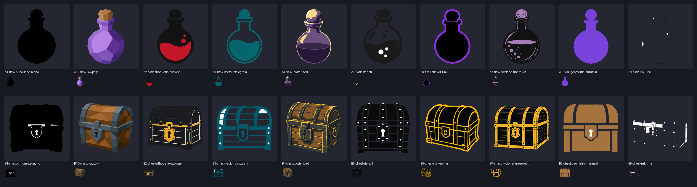
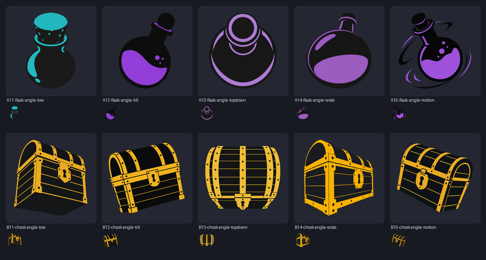
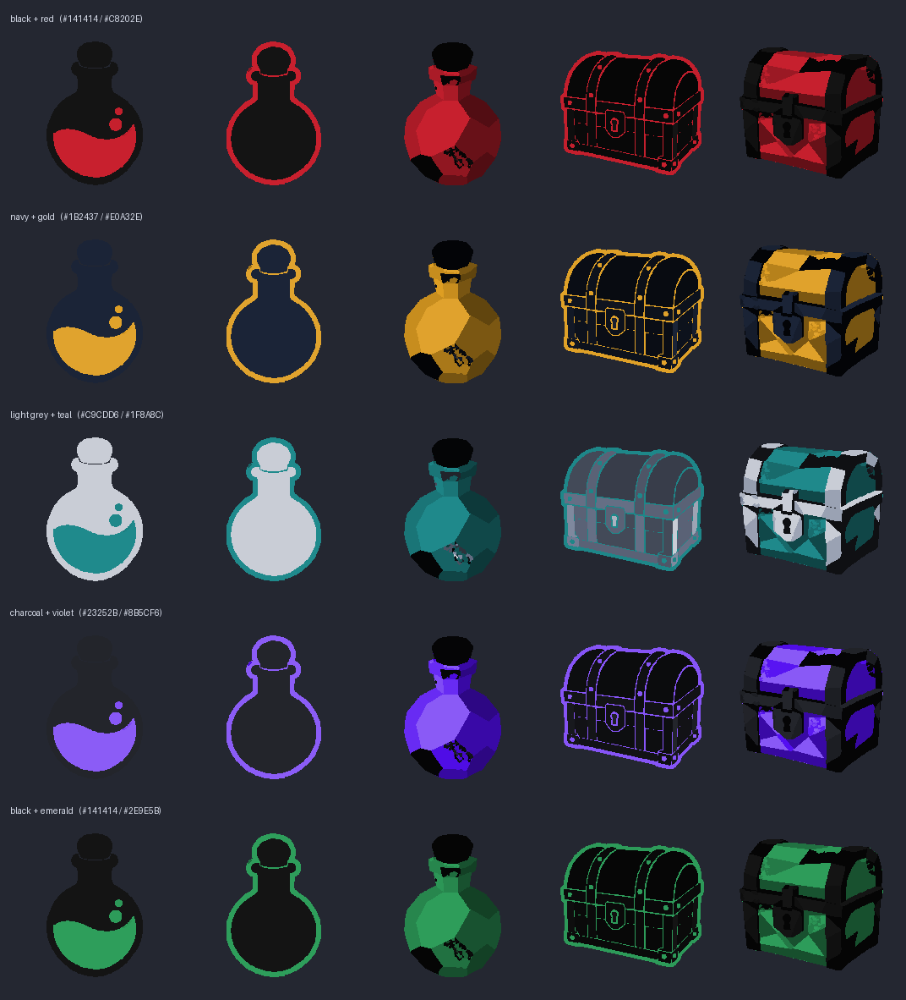
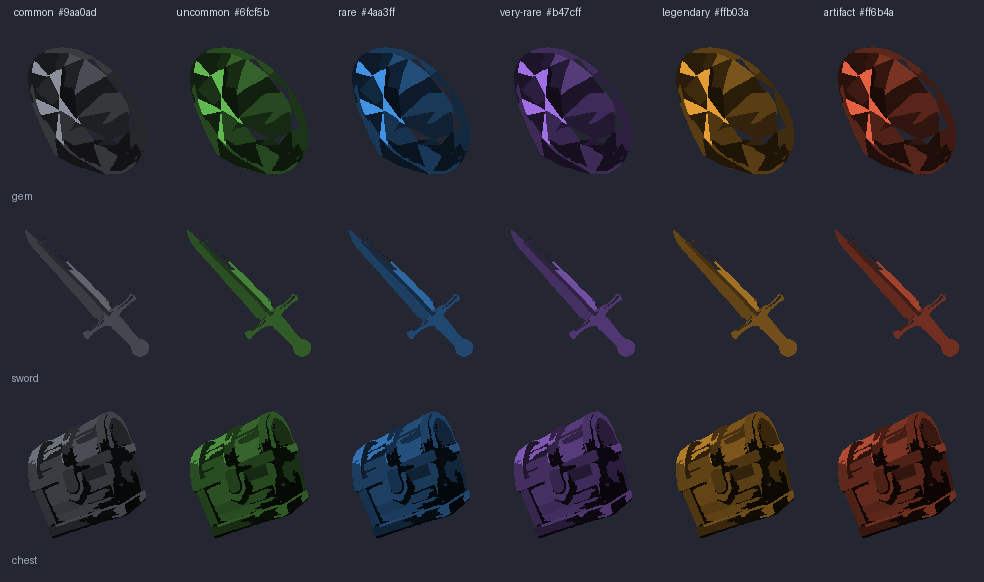

# Loot Icons — исходники иконок предметов для D&D 5e

Набор иконок для предметов в Foundry VTT. Не «одна картинка на каждый
предмет», а **шаблоны-архетипы**: один силуэт закрывает целый класс предметов.

В репозитории лежат **только исходники иконок** и пайплайн, который их
производит. Никакого модуля Foundry, никаких хуков, никакого словаря
автоприсвоения — это отдельная задача, если она понадобится.

## Структура

```
library.json                  список иконок: путь → исходник в src/masters
icons/<категория>/<имя>.png   мастер 512×512, прозрачный фон
icons/<категория>/<имя>.svg   вектор, трассировка из плоского арта
icons/<категория>/<имя>.webp  200×200, готов к использованию в Foundry
src/masters/<имя>.png         мастер 512×512 — исходник artwork, в git
src/raw/<имя>.png              оригиналы 1024×1024 на белом фоне (не в git)
src/styles/                   кандидаты стилей и ракурсов (не в git)
tools/extract_alpha.py         вырезание фона, снятие ореола, нормализация
tools/build_icons.py           сборка набора: PNG + SVG + WebP
tools/style_sheet.py           сравнительный лист кандидатов
tools/svg_preview.py           рендер SVG в PNG без сторонних библиотек
tools/recolor.py               перекраска вектора: палитра без генерации
tools/rarity.py                цвет по редкости: матрица и статичные варианты
tools/library_sheet.py         лист ревью по отгружаемым файлам
style/bake-off-20.png          сравнение десяти стилей (см. ниже)
style/palette-matrix.png       пять палитр на пяти стилях
style/rarity.png               весь набор в шести редкостях
```

## Категории

`consumables` · `adventuring` · `containers` · `treasure` · `materials` ·
`nature` · `food` · `weapons` · `armor` · `magic`

## Стиль: от деталей к силуэтам

Первая версия была детализированным digital art — на 40 px в инвентаре
превращалась в кашу. Вторая итерация — силуэты. Сравнение десяти подходов на
двух предметах (флакон и сундук), крупно и в 40 px:



| Вариант | Что получилось | Итог |
|---------|----------------|------|
| **A1 / B1** чистый моно-силуэт | флакон — идеальный силуэт; сундук — бесформенное пятно | годится только для простых форм |
| **A2 / B2** плоский двухтон | чёрный силуэт + один акцентный цвет | форма читается, акцент даёт цвет, на 40 px живо |
| **A3 / B3** плоский пиктограмм | контурный векторный стиль | чисто, но контур «съедает» читаемость в мелком размере |
| **A4 / B4** постеризация | digital art, свёрнутый в три тона | красиво, но это всё ещё «детализированный объект» |
| **A5 / B5** трафарет | негативное пространство вместо деталей | не вышло: превращается в кашу из точек |
| **A6 / B6** стикер с обводкой | чёрная форма + яркая обводка | **максимальный контраст**, обводка сама даёт цвет предмета |
| **A7 / B7** двухтон + штрихи | два тона и тонкие акцентные линии | красиво, но линии теряются на 40 px |
| **A8 / B8** геометрический минимализм | три-четыре простые фигуры | очень чисто, но обобщённо и «по-детски» |
| **A9 / B9** штриховая графика | рисунок одной линией | на 40 px не виден вообще — отпадает |
| **A10 / B10** low-poly | крупные грани в двух тонах | **сохраняет дух digital art** и при этом читается силуэтом |

### Ракурс — отдельное измерение

Первые прогоны держали один статичный «3/4 сверху» для всех иконок, поэтому
сравнивался стиль, а не подача. Ракурс оказался важнее: пять вариантов камеры
на тех же двух предметах, стиль зафиксирован.



| Ракурс | Флакон | Сундук | Итог |
|--------|--------|--------|------|
| **снизу вверх** | пробка нависает камерой | крышка раскрывается к зрителю | мощно, но флакон теряет форму |
| **наклонная диагональ** | наклон, жидкость смещается | сундук завалился | **читается, динамично, без потери силуэта** |
| **сверху вниз** | концентрические круги | читается уже как бочка | графично, но предмет перестаёт узнаваться |
| **широкий угол** | близкий край нависает | ближний угол огромен | **сильнее всего читается перспектива** |
| **движение** | закрученный флакон со шлейфом | летящий сундук | **самый характерный, видно движение** |

### Побочный эффект: чем площе стиль, тем чище вектор

| Иконка | PNG 512 | SVG | path'ов |
|--------|---------|-----|---------|
| моно-силуэт флакона | 81 КБ | **5 КБ** | 1 |
| геометрический флакон | 99 КБ | **7 КБ** | 4 |
| двухтон флакона | 88 КБ | 12 КБ | 7 |
| стикер-флакон | 92 КБ | 14 КБ | 4 |
| low-poly сундук | 231 КБ | 184 КБ | 86 |
| постеризованный сундук | 231 КБ | 548 КБ | 443 |

Детализированный объект в векторе раздувается в сотни path'ов и весит полмегабайта.
Силуэт даёт килобайты и остаётся резким на любом размере.

### Палитра — отдельно от стиля

Трассировка даёт плоские заливки, поэтому палитра меняется перекраской вектора
(`tools/recolor.py`) — **без единой генерации**. Цвета группируются по семействам
(акцент / светлый / тёмный), и каждое семейство переносится на новый оттенок с
сохранением относительной светлоты.



Один и тот же стиль даёт все пять палитр, и цвет предмета становится
свободным параметром: жидкость в зелье — красная, обводка сундука — золотая,
а форма всегда одна и та же.

## Цвет — это редкость, а не материал

Иконка — это **форма**. Цвет несёт **редкость**, а не материал: одно и то же
изображение работает для обычного, редкого и легендарного предмета, меняется
только цвет.

Поэтому отгружаемый мастер — **нейтральный** (обесцвеченный), а цвет
подставляется:

```bash
# матрица «иконка × редкость» для ревью
python tools/rarity.py icons/treasure/gem.svg icons/weapons/sword.svg \
    --preview preview/rarity.png

# статичные варианты под конкретную редкость
python tools/rarity.py icons/treasure/gem.svg --export legendary
```



Цвет задаётся редкостью, а не материалом предмета: зелье и кинжал одного
уровня выглядят одинаково, если у них одинаковая редкость.

| редкость | цвет |
|----------|------|
| common | серый `#9aa0ad` |
| uncommon | зелёный `#6fcf5b` |
| rare | синий `#4aa3ff` |
| very rare | фиолетовый `#b47cff` |
| legendary | золотой `#ffb03a` |
| artifact | красный `#ff6b4a` |

Раскраска сохраняет светлоту каждого тона, поэтому объём и тени остаются
читаемыми — иконка не выглядит залитой цветной заплатой.

### В Foundry

Самый простой способ — маска: нейтральная иконка становится силуэтом цвета
редкости прямо в листе.

```css
/* в стиль или в макрос, по вкусу */
.item[data-rarity="uncommon"] img {
  -webkit-mask-image: var(--icon);
  mask-image: var(--icon);
  -webkit-mask-size: contain;
  mask-size: contain;
  -webkit-mask-repeat: no-repeat;
  mask-repeat: no-repeat;
  background-color: #6fcf5b;
}
```

Либо статичные файлы: `tools/rarity.py --export legendary` кладёт рядом
`<имя>.legendary.svg`, и макрос подставляет нужный путь в `item.img`.

## Текущий стиль

**Постеризованный digital art + наклонная диагональ.**

* стиль — высокий контраст, три плоских тона, жёсткие края, без мелких деталей;
* ракурс — предмет завален на диагональ, как будто пойман в движении;
* палитра — задаётся перекраской вектора, цвет предмета от формы не зависит.

Набор собирается заново, по одному правилу на предмет: **камера выбирается
под форму**, а **цвет означает редкость**. Первый проход, где у всех была одна
и та же диагональ, удалён целиком.

| | PNG 512 | SVG | path'ов |
|---|---|---|---|
| мумифицированная рука гоблина | 115 КБ | 35 КБ | 10 |

### Рецепт вектора

Постеризация арта до шести цветов **перед** трассировкой плюс агрессивные
параметры трассера (`filter_speckle=48`, `corner_threshold=180`,
`path_precision=1`) дают 7–25 path'ов вместо 500 и чистый результат.
Проверено перебором: постеризация после трека, `color_precision` трассера
и размытие перед треком давали либо артефакты, либо файлы по мегабайту.

## Ракурс подбирается под предмет

Один ракурс на весь набор не работает: для круглых предметов (флакон, кольцо,
самоцвет) динамичный наклон читается отлично, а для вытянутых (меч, свиток) и
объёмных (рюкзак, шлем) тот же приём ломает силуэт.

Поэтому на каждый предмет — **несколько кандидатов с разной камерой**, из них
выбирается лучший. Кандидаты кладутся в `src/styles/`, лист сравнения
собирается командой:

```bash
python tools/style_sheet.py src/styles "V*.png"    # лист по предметам
```

Рекомендации по предметам, которые набрались на прошлом проходе:

| предмет | камера | почему |
|---|---|---|
| флакон, склянка | в движении | закрученный силуэт со шлейфом, самый узнаваемый |
| книга | в движении | повёрнутая обложка, больше характера, чем у наклона |
| бутылка | снизу | героическая камера, читается на 40 px |
| фонарь | в полёте | дуга ручки задаёт диагональ сама по себе |
| верёвка | петлёй | самый узнаваемый силуэт из всех вариантов |
| рюкзак | наклон | остальные варианты размывают силуэт на 40 px |
| слиток, руда | наклон | плоская форма, наклон даёт объём |
| мешок | кренится | мешку нужен вес, а не динамика |
| хлеб | сверху | снизу каравай не читается |
| мумифицированная рука | наклон | перстень и бинты дают фокус, диагональ удерживает динамику |

## Как добавить иконку

1. Положить оригинал в `src/raw/<имя>.png` (1024×1024, белый фон).
   Оригинал не обязателен: если его нет, сборка берёт готовый мастер из
   `src/masters/`, поэтому набор всегда пересобирается из репозитория.
2. Добавить строку в `library.json`.
3. Собрать:

```bash
python3 -m venv .venv && .venv/bin/pip install pillow numpy scipy vtracer
.venv/bin/python tools/build_icons.py
```

Сборка нарезает фон, снимает белый ореол, приводит объект к 84 % кадра
(одинаковый визуальный вес всего набора), сохраняет мастер, трассирует вектор
и делает webp 200×200.

### Промпт-шаблон

```
Single game inventory icon, <стиль>, three-quarter view from slightly above:
<предмет>. Bold readable silhouette, simple readable shapes, high contrast,
centered, subject fills about 85 percent of the square frame, isolated on a
seamless pure white studio background, no shadow, no ground plane, no
reflection, no text, no border, no frame, no watermark, no UI, no extra
objects, no hands
```

Для двухтонового варианта к описанию предмета добавляется:
`rendered as a flat two-tone graphic: a solid matte near-black silhouette with
one flat <цвет> accent area, no gradients, no texture, no shading, crisp hard
edges, bold and iconic`.

## Лицензия

* Код пайплайна — MIT ([LICENSE](LICENSE)).
* Иллюстрации — CC BY 4.0 ([LICENSE-ASSETS.md](LICENSE-ASSETS.md)).

Арт сгенерирован с нуля, без ассетов из коммерческих игр.
