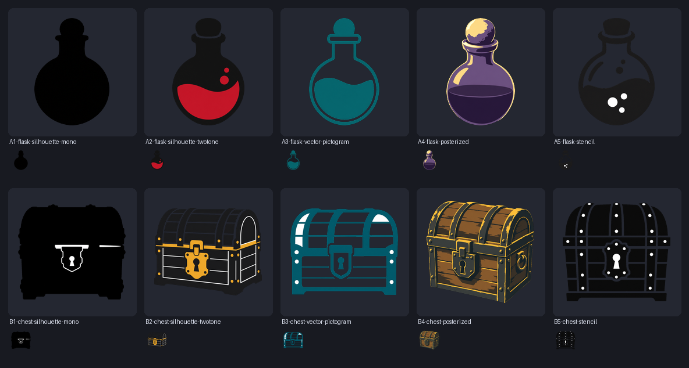

# Loot Icons — исходники иконок предметов для D&D 5e

Набор иконок для предметов в Foundry VTT. Не «одна картинка на каждый
предмет», а **шаблоны-архетипы**: один силуэт закрывает целый класс предметов.

В репозитории лежат **только исходники иконок** и пайплайн, который их
производит. Никакого модуля Foundry, никаких хуков, никакого словаря
автоприсвоения — это отдельная задача, если она понадобится.

## Структура

```
library.json                  список иконок: путь → исходник в src/raw
icons/<категория>/<имя>.png   мастер 512×512, прозрачный фон
icons/<категория>/<имя>.svg   вектор, трассировка из плоского арта
icons/<категория>/<имя>.webp  200×200, готов к использованию в Foundry
src/raw/<имя>.png              оригиналы 1024×1024 на белом фоне (не в git)
src/styles/                   кандидаты стилей (не в git)
tools/extract_alpha.py         вырезание фона, снятие ореола, нормализация
tools/build_icons.py           сборка набора: PNG + SVG + WebP
tools/style_sheet.py           сравнительный лист кандидатов
tools/svg_preview.py           рендер SVG в PNG без сторонних библиотек
style/bake-off-2026-10-18.png  сравнение стилей (см. ниже)
archive/v1-detailed/           предыдущая версия: детализированный digital art
```

## Категории

`consumables` · `adventuring` · `containers` · `treasure` · `materials` ·
`nature` · `food` · `weapons` · `armor` · `magic`

## Стиль: от деталей к силуэтам

Первая версия была детализированным digital art — на 40 px в инвентаре
превращалась в кашу. Вторая итерация — силуэты. Сравнение пяти подходов на
одном предмете (флакон и сундук, крупно и в 40 px):



| Вариант | Что получилось | Итог |
|---------|----------------|------|
| **A1 / B1** чистый моно-силуэт | флакон — идеальный силуэт; сундук — бесформенное пятно | годится только для простых форм |
| **A2 / B2** плоский двухтон | чёрный силуэт + один акцентный цвет | **сработал лучше всего**: форма читается, акцент даёт цвет, на 40 px всё живо |
| **A3 / B3** плоский пиктограмм | контурный векторный стиль | чисто, но контур «съедает» читаемость в мелком размере |
| **A4 / B4** постеризация | digital art, свёрнутый в три тона | красиво, но это всё ещё «детализированный объект» |
| **A5 / B5** трафарет | негативное пространство вместо деталей | не вышло: превращается в кашу из точек |

Побочный, но важный эффект: **чем площе стиль, тем чище вектор**.

| Иконка | PNG 512 | SVG | path'ов |
|--------|---------|-----|---------|
| моно-силуэт флакона | 81 КБ | **5 КБ** | 1 |
| двухтон флакона | 88 КБ | **9,5 КБ** | 5 |
| пиктограмм сундука | 99 КБ | 45 КБ | 21 |
| двухтон сундука | 161 КБ | 155 КБ | 129 |
| постеризованный сундук | 231 КБ | 548 КБ | 443 |

Детализированный объект в векторе раздувается в сотни path'ов и весит полмегабайта.
Силуэт даёт десять килобайт и остаётся резким на любом размере.

## Как добавить иконку

1. Положить оригинал в `src/raw/<имя>.png` (1024×1024, белый фон).
2. Добавить строку в `library.json`.
3. Собрать:

```bash
python3 -m venv .venv && .venv/bin/pip install pillow numpy scipy vtracer
.venv/bin/python tools/build_icons.py
```

Сборка нарезает фон, снимает белый ореол, приводит объект к 84 % кадра
(одинаковый визуальный вес всего набора), сохраняет мастер, трассирует вектор
и делает webp 200×200.

### Промпт-шаблон

```
Single game inventory icon, <стиль>, three-quarter view from slightly above:
<предмет>. Bold readable silhouette, simple readable shapes, high contrast,
centered, subject fills about 85 percent of the square frame, isolated on a
seamless pure white studio background, no shadow, no ground plane, no
reflection, no text, no border, no frame, no watermark, no UI, no extra
objects, no hands
```

Для двухтонового варианта к описанию предмета добавляется:
`rendered as a flat two-tone graphic: a solid matte near-black silhouette with
one flat <цвет> accent area, no gradients, no texture, no shading, crisp hard
edges, bold and iconic`.

## Лицензия

* Код пайплайна — MIT ([LICENSE](LICENSE)).
* Иллюстрации — CC BY 4.0 ([LICENSE-ASSETS.md](LICENSE-ASSETS.md)).

Арт сгенерирован с нуля, без ассетов из коммерческих игр.
